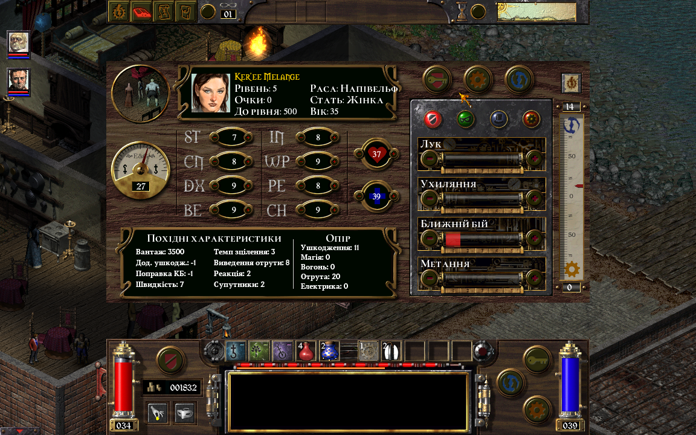
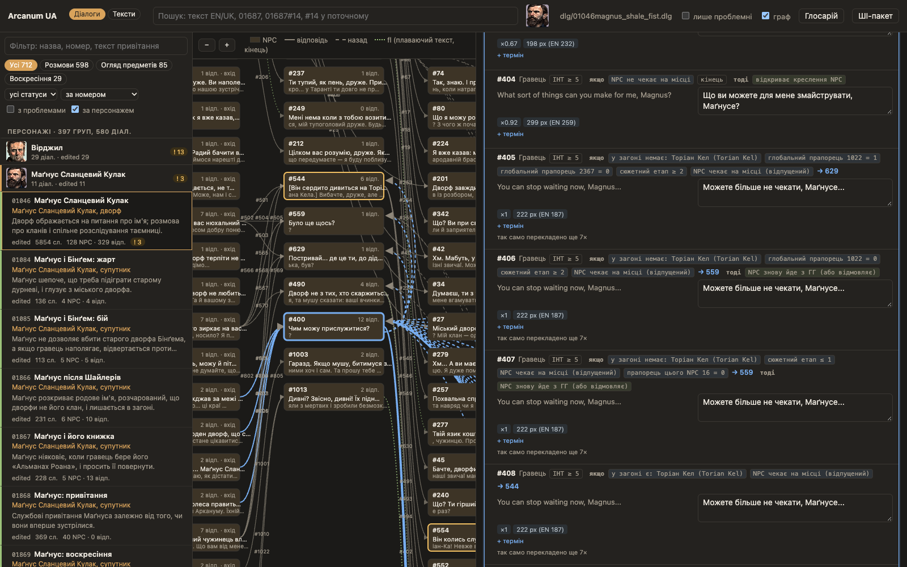
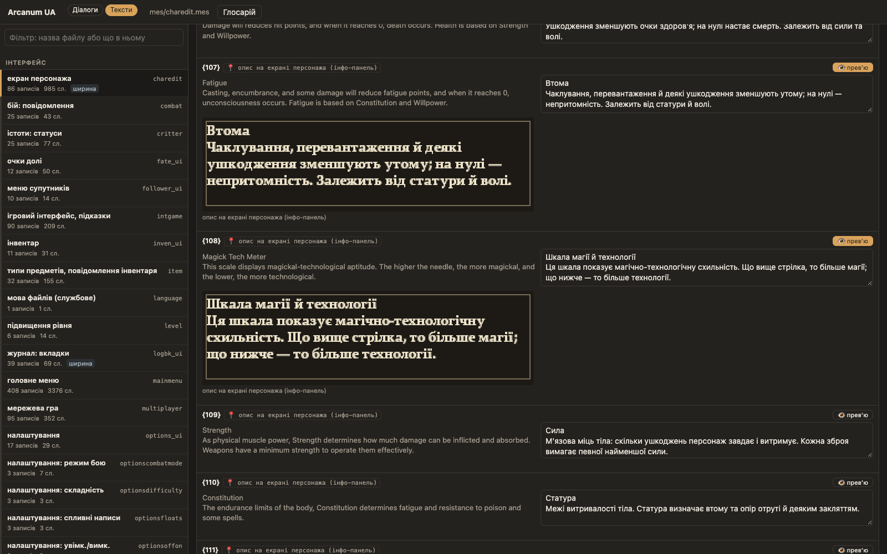

# Arcanum: Of Steamworks and Magick Obscura — українська локалізація

Неофіційний фанатський переклад Arcanum (Troika Games, 2001) українською.

> **⚠️ Переклад зроблено штучним інтелектом.**
> Увесь текст переклала й відредагувала мовна модель Claude (Anthropic): переклад, звірку з оригіналом
> і літературну редактуру виконано ШІ за спільним глосарієм, стайлгайдом і автоматичними перевірками.
> Людина керувала проєктом, ухвалювала рішення й перевіряла переклад у грі, але не вичитувала кожен рядок.
> Помилки, кальки й незграбності можливі — повідомлення про них дуже вітаються.

## Скріншоти

| | |
|---|---|
|  |  |
|  |  |



## Завантажити

Готовий архів — у розділі [Releases](../../releases). Інструкція зі встановлення — у `ЧИТАЙМЕНЕ.txt`
всередині архіву (коротко: розпакувати поверх теки гри з заміною файлів).

Потрібна власна ліцензійна копія гри (GOG або Steam). Перевірено на Windows: GOG-версія +
Unofficial Arcanum Patch.

## Що перекладено

- 100% тексту гри: діалоги (712 файлів), предмети, закляття, схеми, журнал квестів, книжки, газети,
  інтерфейс — ~840 тис. слів оригіналу.
- Шрифти гри з кирилицею: меню й назви (Morpheus, morph30/morph15) зібрано з оригінальних латинських
  літер самої гри, вкладки журналу й рубрики газети (zurich16) намальовано попіксельно в стилі
  оригіналу, решту домальовано з вільних шрифтів (див. `dist-docs/ШРИФТИ.txt`).
- Озвучка лишається англійською.

## Вміст репозиторію

| тека | що там |
|---|---|
| `uk/` | переклад: `.mes` і `.dlg` у UTF-8 (у гру йдуть у cp1251) |
| `fonts/` | шрифти `*.art` з кирилицею |
| `glossary/glossary.tsv` | глосарій: імена, назви, терміни |
| `docs/style.md` | стайлгайд перекладу |
| `docs/dlg-index.tsv` | покажчик діалогів: назва, хто говорить, де, про що |
| `tools/` | інструменти на Python 3 без залежностей (генерація шрифтів потребує Pillow) |
| `dist-docs/` | файли, що кладуться в архів релізу |

Оригінальних текстів чи ресурсів гри в репозиторії немає. Щоб працювати з інструментами, витягніть
англійський текст зі своєї копії гри:

```
python3 tools/extract.py "C:/GOG Games/Arcanum"   # -> source/
python3 tools/qa.py                                # перевірка структури перекладу проти source/
python3 tools/widthcheck.py                        # чи влазять назви й описи
python3 tools/newscheck.py                         # розкладка газет
python3 tools/package.py 1.0                       # -> dist/arcanum-ua-1.0.zip
```

Кирилицю Morpheus (меню, назви предметів і заклять) збирає `tools/morphcyr.py` із латинських літер
вашої копії гри: спільні форми копіюються (А=A, В=B), інші віддзеркалюються, вирізаються чи
складаються (Я — дзеркальна R, Л — A без поперечки, Ж — дві K), бракуючі штрихи домальовуються
товщиною основної лінії. Потрібен Pillow.

```
python3 tools/morphcyr.py --game "C:/GOG Games/Arcanum" --font morph30   # також morph15, morph15_system
python3 tools/morphcyr.py --font morph15 --preview morph15.png            # аркуш для огляду
python3 tools/zurichcyr.py --game "C:/GOG Games/Arcanum"                 # zurich16: копії + попіксельні мапи
```

## Редактор діалогів



Локальний веб-інструмент для перекладача (Python 3, без залежностей). Потрібен витягнутий `source/`
(див. вище):

```
python3 tools/editor.py        # -> http://127.0.0.1:8765
```

- Граф діалогу за правилами рушія: репліки NPC, відповіді гравця, переходи, точки входу.
- Оригінал поруч із перекладом, правка просто в картці. Запис зберігає структуру файлу (ID, поле
  жіночого тексту, фільтр статі, закінчення рядків) і відмовляє, якщо запис тим часом змінили на диску;
  після запису сам запускає `qa.py` для файлу.
- Живі підказки: плейсхолдери, глосарій, гендерні форми в спільних репліках гравця, ширина у шрифті гри.
- Глосарій поруч із кожною реплікою (клік вставляє форму), пошук і правка `glossary.tsv` просто в редакторі;
  пам'ять перекладів: як та сама англійська репліка перекладена в інших діалогах.
- Пошук за текстом і номером (`01687`, `01687#14`), список із покажчиком `docs/dlg-index.tsv`.
- «За персонажем»: список згруповано за тим, хто говорить, з аватаркою (портрет супутника або спрайт
  NPC). Картинки й зв'язок «діалог → NPC» читаються з вашої копії гри (`tools/npcart.py`, кеш у
  `~/.cache/arcanum-ua/`); у репозиторії їх немає. Гру шукає в `/Applications/Arcanum`, інакше вкажіть
  шлях: `ARCANUM_GAME="C:/GOG Games/Arcanum" python3 tools/editor.py`. Без гри редактор працює без аватарок.
- Умови й ефекти реплік людською мовою («Переконання ГГ ≥ 5», «квест 1023 → виконаний», «ГГ платить
  NPC 100 золота»), сирий код і деталі (текст квесту, чутки, коментар до прапорця) — у підказці
  (`tools/dlgcodes.py`, за кодом рушія `dialog.c`).
- Режим «Тексти»: усі `.mes` (інтерфейс, назви й описи предметів, закляття, журнал, газета, загальні
  репліки) з тими самими перевірками. Біля запису — де він показується в грі і прев'ю: рядок
  намальовано шрифтом гри з переносом рушія в рамці реального розміру, те, що не влазить, — червоним
  (`tools/textpreview.py`). Посилання на запис: `#mes/description.mes:11138`.


- «ШІ-пакет»: контекст для іншої мовної моделі (записи, сусідні репліки, глосарій, стайлгайд,
  обмеження) і імпорт її відповіді лише через diff із поштучним прийняттям.

## Що в архіві і чого там немає

Архів містить лише перекладені тексти та шрифти. Жодних оригінальних текстів, графіки, звуку чи
виконуваних файлів гри — для роботи потрібна власна ліцензійна копія (GOG або Steam). Оригінальні шрифти гри
кирилиці не мали: у Morpheus (меню, назви) її зібрано з латинських літер самої гри, у zurich16 — намальовано
попіксельно в тому ж стилі, в інших шрифтах —
домальовано з вільних шрифтів (SIL Open Font License і ParaType Free Font License); комерційні
кириличні шрифти в проєкт не брали.

## Ліцензія

- Переклад (`uk/`, `glossary/`, `docs/`): [CC BY-NC-SA 4.0](https://creativecommons.org/licenses/by-nc-sa/4.0/).
- Інструменти (`tools/`): MIT.
- Шрифти: кирилиця Morpheus (morph15/morph30) зібрана з латинських кадрів гри, zurich16 — намальована
  попіксельно; решта згенерована з Forum,
  Old Standard TT, Marck Script (SIL OFL 1.1) і PT Serif / PT Sans (ParaType Free Font License);
  латинські кадри — оригінальні з гри. Див. `dist-docs/ШРИФТИ.txt`.

Arcanum — торгова марка відповідних правовласників (Troika Games / Activision / Microsoft).
Проєкт ніяк із ними не пов'язаний.
