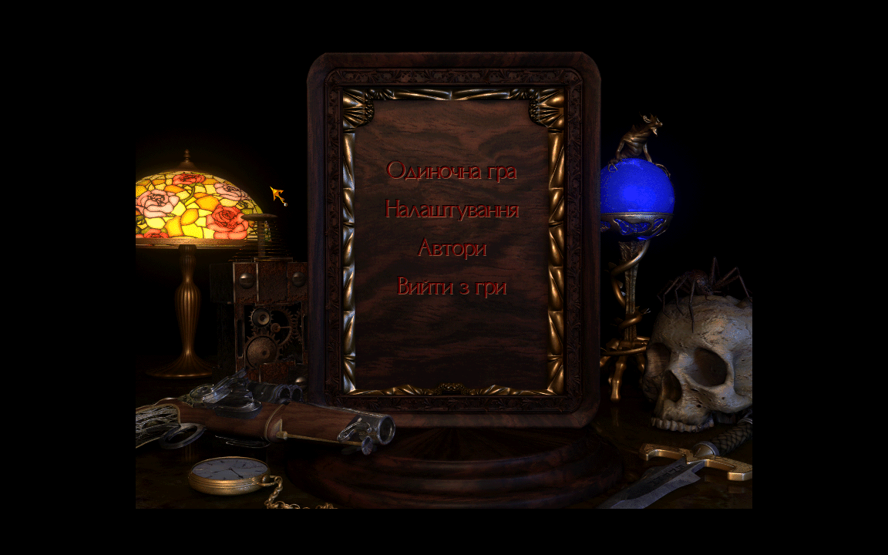
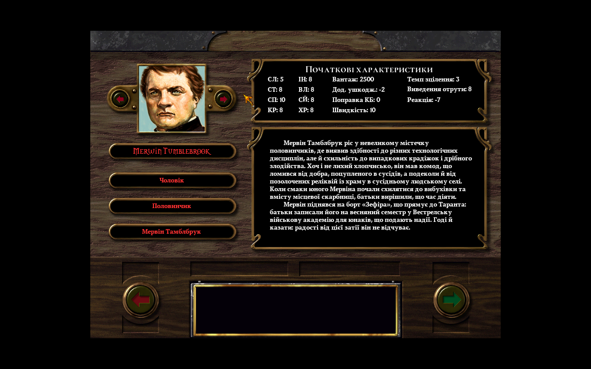
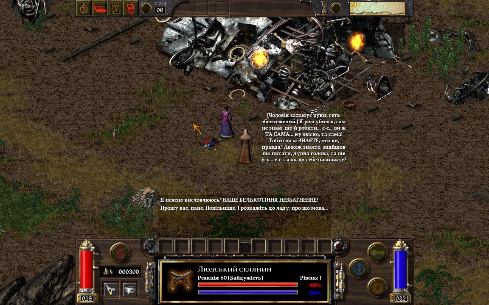
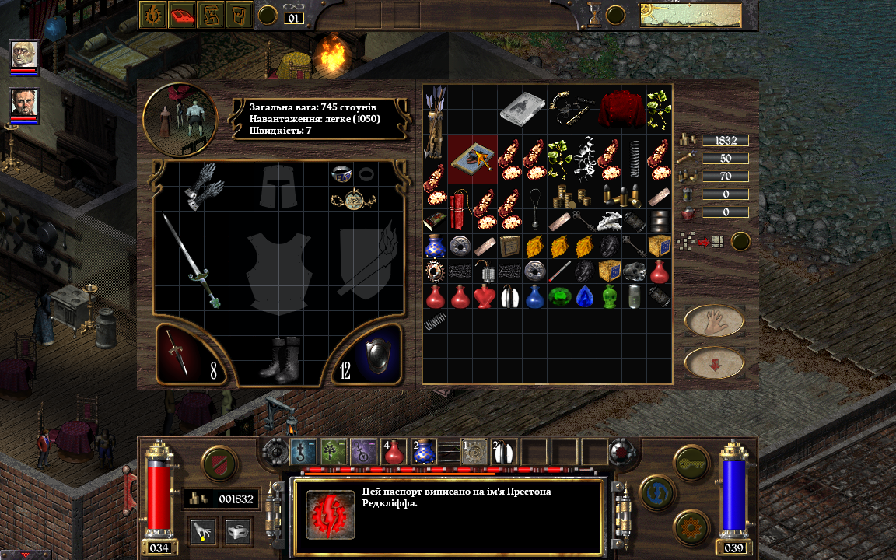

# Arcanum: Of Steamworks and Magick Obscura — українська локалізація

Неофіційний фанатський переклад Arcanum (Troika Games, 2001) українською.

> **⚠️ Переклад зроблено штучним інтелектом.**
> Увесь текст переклала й відредагувала мовна модель Claude (Anthropic): переклад, звірку з оригіналом
> і літературну редактуру виконано ШІ за спільним глосарієм, стайлгайдом і автоматичними перевірками.
> Людина керувала проєктом, ухвалювала рішення й перевіряла переклад у грі, але не вичитувала кожен рядок.
> Помилки, кальки й незграбності можливі — повідомлення про них дуже вітаються.

## Скріншоти

| | |
|---|---|
|  |  |
|  |  |


## Завантажити

Готовий архів — у розділі [Releases](../../releases). Інструкція зі встановлення — у `ЧИТАЙМЕНЕ.txt`
всередині архіву (коротко: розпакувати поверх теки гри з заміною файлів).

Потрібна власна ліцензійна копія гри (GOG або Steam). Перевірено на Windows: GOG-версія +
Unofficial Arcanum Patch.

## Що перекладено

- 100% тексту гри: діалоги (712 файлів), предмети, закляття, схеми, журнал квестів, книжки, газети,
  інтерфейс — ~840 тис. слів оригіналу.
- Шрифти гри з домальованою кирилицею (з вільних шрифтів, див. `dist-docs/ШРИФТИ.txt`).
- Озвучка лишається англійською.

## Вміст репозиторію

| тека | що там |
|---|---|
| `uk/` | переклад: `.mes` і `.dlg` у UTF-8 (у гру йдуть у cp1251) |
| `fonts/` | шрифти `*.art` з кирилицею |
| `glossary/glossary.tsv` | глосарій: імена, назви, терміни |
| `docs/style.md` | стайлгайд перекладу |
| `tools/` | інструменти на Python 3 без залежностей (генерація шрифтів потребує Pillow) |
| `dist-docs/` | файли, що кладуться в архів релізу |

Оригінальних текстів чи ресурсів гри в репозиторії немає. Щоб працювати з інструментами, витягніть
англійський текст зі своєї копії гри:

```
python3 tools/extract.py "C:/GOG Games/Arcanum"   # -> source/
python3 tools/qa.py                                # перевірка структури перекладу проти source/
python3 tools/widthcheck.py                        # чи влазять назви й описи
python3 tools/newscheck.py                         # розкладка газет
python3 tools/package.py 1.0                       # -> dist/arcanum-ua-1.0.zip
```

## Що в архіві і чого там немає

Архів містить лише перекладені тексти та шрифти. Жодних оригінальних текстів, графіки, звуку чи
виконуваних файлів гри — для роботи потрібна власна ліцензійна копія (GOG або Steam). Кирилицю в
шрифтах домальовано з вільних шрифтів (SIL Open Font License і ParaType Free Font License), тому
вони трохи відрізняються від оригінальних: оригінальні шрифти гри кирилиці не мали, а комерційні
кириличні шрифти в проєкт не брали.

## Ліцензія

- Переклад (`uk/`, `glossary/`, `docs/`): [CC BY-NC-SA 4.0](https://creativecommons.org/licenses/by-nc-sa/4.0/).
- Інструменти (`tools/`): MIT.
- Шрифти: кирилиця згенерована з Forum, Cormorant Unicase, Old Standard TT, Marck Script (SIL OFL 1.1) і
  PT Serif / PT Sans (ParaType Free Font License); латинські кадри — оригінальні з гри. Див. `dist-docs/ШРИФТИ.txt`.

Arcanum — торгова марка відповідних правовласників (Troika Games / Activision / Microsoft).
Проєкт ніяк із ними не пов'язаний.
